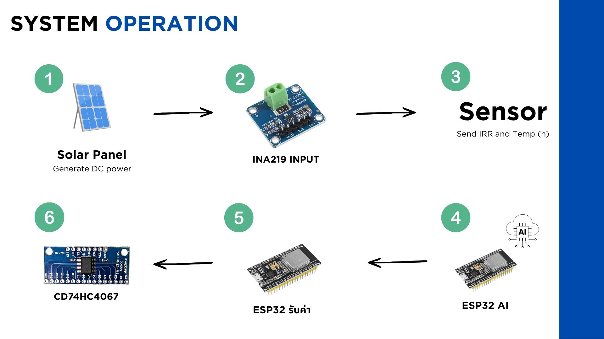
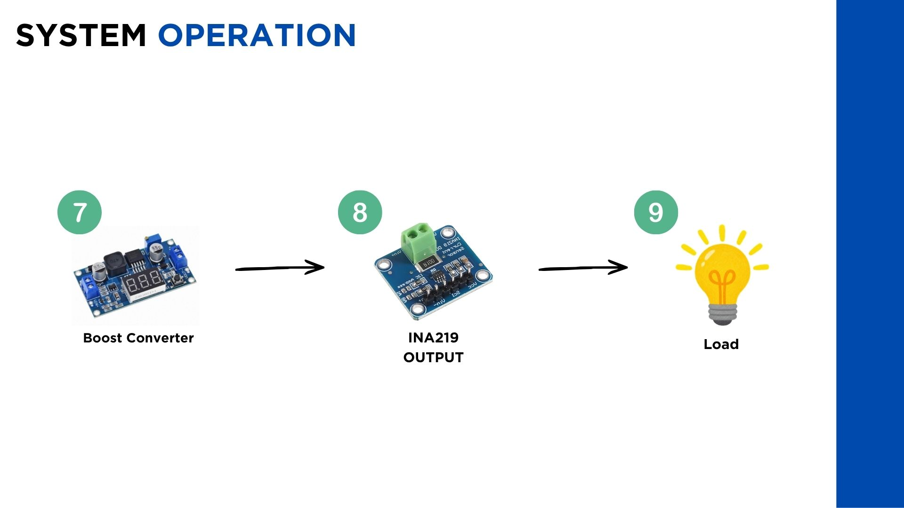
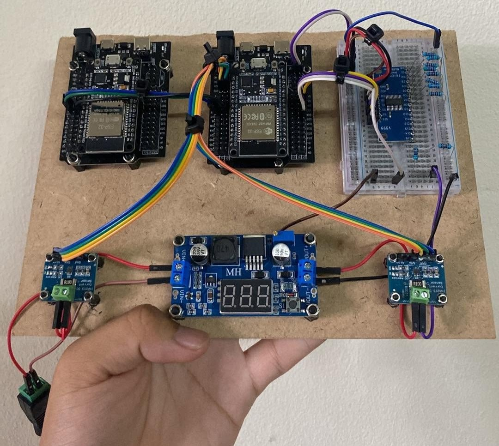
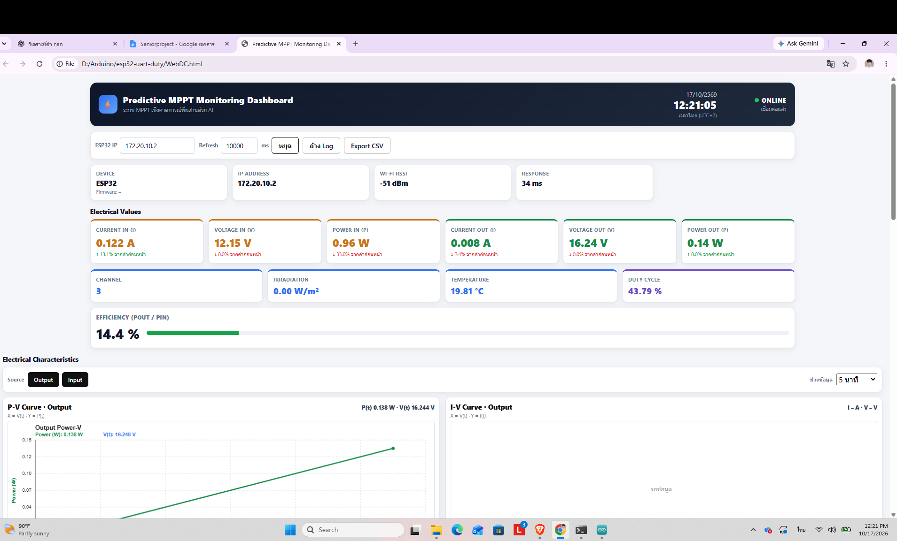

# ESP32 MPPT & Boost Converter Monitoring System

ระบบต้นแบบสำหรับศึกษาการควบคุม DC-DC Boost Converter และการติดตามจุดกำลังไฟฟ้าสูงสุด (Maximum Power Point Tracking: MPPT) โดยใช้ ESP32 จำนวน 2 ตัว สื่อสารผ่าน UART พร้อมเว็บ Dashboard สำหรับติดตามค่าทางไฟฟ้าผ่าน Wi-Fi

ระบบใช้ XL6009 เป็นวงจรเพิ่มแรงดัน และใช้ CD74HC4067 เลือกตัวต้านทานในวงจร Feedback เพื่อปรับแรงดันขาออกแบบ 8 ช่อง

## วัตถุประสงค์

- ศึกษาการปรับแรงดันขาออกของ Boost Converter ด้วยไมโครคอนโทรลเลอร์
- ทดลองอัลกอริทึม Perturb and Observe (P&O) สำหรับการเลือกช่องควบคุม
- ทดลองการประมวลผลโมเดล AI บน ESP32
- ตรวจวัดแรงดัน กระแส และกำลังไฟฟ้าด้านขาเข้าและขาออก
- แสดงข้อมูลการทำงานผ่านเว็บ Dashboard

## ภาพรวมระบบ

ระบบแบ่งหน้าที่ระหว่าง ESP32 จำนวน 2 ตัว ดังนี้

| ส่วนประกอบ | หน้าที่ |
|---|---|
| ESP32 #1 — Computation Node | ประมวลผล AI และอัลกอริทึมเลือกช่องควบคุม |
| ESP32 #2 — Control & Measurement Node | รับคำสั่ง ควบคุม CD74HC4067 อ่าน INA219 และให้บริการข้อมูลผ่าน Wi-Fi |
| XL6009 Boost Converter | เพิ่มแรงดันไฟฟ้ากระแสตรง |
| CD74HC4067 และชุดตัวต้านทาน | เลือกสัดส่วนวงจร Feedback เพื่อปรับแรงดันขาออก |
| INA219 จำนวน 2 ตัว | ตรวจวัดค่าทางไฟฟ้าด้านขาเข้าและขาออก |
| Web Dashboard | แสดงค่าการทำงานและกราฟจากข้อมูลของ ESP32 |

### ลำดับการทำงาน

1. ESP32 #2 อ่านค่าทางไฟฟ้าจาก INA219 และส่งข้อมูลกลับไปยัง ESP32 #1 ผ่าน UART
2. ESP32 #1 ประมวลผลอัลกอริทึมควบคุม และส่งคำสั่งเลือกช่อง 0–7
3. ESP32 #2 เลือกช่องของ CD74HC4067 ตามคำสั่งที่ได้รับ
4. ตัวต้านทานที่เลือกทำให้สัดส่วน Feedback ของ XL6009 เปลี่ยน ส่งผลให้แรงดันขาออกเปลี่ยนตาม
5. ESP32 #2 อ่านค่าทางไฟฟ้ารอบถัดไป เพื่อใช้ประเมินผลของการปรับช่อง
6. เว็บ Dashboard ขอข้อมูลจาก ESP32 #2 ผ่าน HTTP เพื่อแสดงผล

## ภาพรวมระบบ



## วงจรและอุปกรณ์จริง



## Web Dashboard


## การควบคุมแรงดัน

โมดูล XL6009 ปรับแรงดันขาออกโดยอาศัยวงจร Feedback ซึ่งแบ่งแรงดันขาออกบางส่วนกลับไปยังขา FB

โครงงานนี้ใช้ CD74HC4067 เลือกตัวต้านทานที่เชื่อมต่อกับวงจร Feedback จำนวน 8 ช่อง ได้แก่ Y0–Y7 ทำให้สามารถปรับแรงดันเป็นระดับได้ด้วยคำสั่งจาก ESP32

การควบคุมนี้เป็นการเลือกช่องตัวต้านทาน ไม่ใช่การส่งสัญญาณ PWM จาก ESP32 ไปควบคุมสวิตช์กำลังของ XL6009 โดยตรง

แรงดันที่ได้ในแต่ละช่องขึ้นอยู่กับการต่อวงจร Feedback ค่าตัวต้านทาน แรงดันขาเข้า และโหลด จึงต้องตรวจวัดค่าจริงก่อนใช้งาน

## อัลกอริทึม P&O และบทบาทของ AI

### Perturb and Observe (P&O)

P&O เป็นวิธีทดลองเปลี่ยนจุดทำงาน แล้วสังเกตว่ากำลังไฟฟ้าเพิ่มขึ้นหรือลดลง

สำหรับระบบนี้ การเปลี่ยนจุดทำงานทำผ่านการเลือกช่องตัวต้านทาน:

- หากเปลี่ยนช่องแล้วกำลังไฟฟ้าเพิ่มขึ้น อัลกอริทึมจะพิจารณาปรับต่อในทิศทางเดิม
- หากกำลังไฟฟ้าลดลง อัลกอริทึมจะพิจารณากลับทิศทาง
- การตัดสินใจใช้ข้อมูลกำลังไฟฟ้าที่ตรวจวัดจากวงจร

เนื่องจากมีช่องควบคุมเพียง 8 ช่อง ระบบจึงค้นหาจุดทำงานได้เฉพาะระดับที่ฮาร์ดแวร์รองรับ

### บทบาทของ AI ในเวอร์ชันทดลอง

ESP32 #1 รันโมเดล AI เพื่อทดลองการพยากรณ์และคำนวณค่าที่เกี่ยวข้องกับการควบคุมจากข้อมูลทดสอบ

ในเวอร์ชันทดลองที่ใช้ Discrete P&O การเลือกช่องจริงยังอาศัย P&O และค่ากำลังไฟฟ้าที่วัดได้ ส่วนผลจาก AI ใช้เพื่อศึกษาและเปรียบเทียบ ยังไม่ได้ใช้ตัดสินใจเลือกช่องจริงโดยตรง

การนำ AI มาช่วยควบคุมต้องตรวจสอบหน่วย สเกลข้อมูล และความสอดคล้องระหว่างข้อมูลที่ใช้ฝึกโมเดลกับวงจรจริงก่อน รวมถึงทดสอบว่าช่วยให้การควบคุมดีขึ้นจริง

## อุปกรณ์หลัก

| อุปกรณ์ | จำนวน | รายละเอียด |
|---|---:|---|
| ESP32 | 2 | ประมวลผลและควบคุมระบบ |
| XL6009 Boost Converter | 1 | วงจรเพิ่มแรงดัน |
| CD74HC4067 | 1 | เลือกช่องตัวต้านทาน |
| INA219 | 2 | ตรวจวัดด้านขาเข้าและขาออก |
| ชุดตัวต้านทาน | 8 ค่า | ใช้กับวงจร Feedback |
| แหล่งจ่ายไฟ DC | 1 | จ่ายไฟสำหรับการทดลอง |
| โหลดตัวต้านทาน | 1 ชุด | โหลดสำหรับทดสอบวงจร |

## การเชื่อมต่อฮาร์ดแวร์

### CD74HC4067 กับ ESP32 #2

| ขา CD74HC4067 | GPIO ของ ESP32 #2 |
|---|---:|
| S0 | 25 |
| S1 | 26 |
| S2 | 27 |
| S3 | 14 |

ช่อง Y0–Y7 ใช้เลือกชุดตัวต้านทานที่ต่อกับวงจร Feedback ของ XL6009 โดยต้องอ้างอิงแผนผังวงจรจริงประกอบการต่อสาย

### ที่อยู่ I²C ของ INA219

| ตำแหน่งตรวจวัด | I²C Address |
|---|---|
| ด้านขาเข้า | `0x41` |
| ด้านขาออก | `0x40` |

INA219 ทั้ง 2 ตัวใช้บัส I²C ร่วมกัน โดยต้องตั้งที่อยู่ให้แตกต่างกัน

### UART ระหว่าง ESP32

- TX ของ ESP32 #1 ต่อกับ RX ของ ESP32 #2
- RX ของ ESP32 #1 ต่อกับ TX ของ ESP32 #2
- เชื่อมต่อ GND ร่วมกัน
- ตั้ง Baud rate ให้ตรงกันทั้ง 2 บอร์ด

ตรวจสอบหมายเลข GPIO ของ UART และ I²C จากโค้ดของแต่ละบอร์ดก่อนต่อสาย

## การติดตั้งและอัปโหลดเฟิร์มแวร์

1. ติดตั้ง Arduino IDE และแพ็กเกจบอร์ด ESP32
2. ดาวน์โหลดหรือ Clone Repository นี้
3. ติดตั้งไลบรารีตามรายการ `#include` ในโค้ดของแต่ละบอร์ด
4. ตรวจสอบว่าไฟล์โมเดล AI และไฟล์ Header ที่จำเป็นอยู่ครบ
5. ตั้งชื่อโฟลเดอร์ Arduino ให้ตรงกับชื่อไฟล์ `.ino` หลัก
6. ตรวจสอบ GPIO และการต่อวงจรให้ตรงกับโค้ด
7. ตั้งค่าชื่อและรหัสผ่าน Wi-Fi ในเฟิร์มแวร์ของ ESP32 #2
8. เลือกบอร์ดและพอร์ตให้ถูกต้อง แล้วอัปโหลดเฟิร์มแวร์แยกไปยัง ESP32 แต่ละตัว
9. เปิด Serial Monitor โดยใช้ Baud rate ตาม `Serial.begin(...)`
10. ตรวจสอบการสื่อสาร UART การอ่าน INA219 และ IP address ของ ESP32 #2

ห้ามเผยแพร่รหัสผ่าน Wi-Fi, API Key หรือ Token จริงลงใน Repository

## การเปิด Web Dashboard

เว็บ Dashboard ดึงข้อมูลจาก ESP32 #2 ผ่านเครือข่าย โดยคอมพิวเตอร์ต้องสามารถเข้าถึง IP ของบอร์ดได้

### 1. ตรวจสอบ API ของ ESP32

ดู IP address จาก Serial Monitor แล้วเปิดในเบราว์เซอร์:

```text
http://<ESP32_IP>/data
```

หากเชื่อมต่อสำเร็จ จะได้รับข้อมูลรูปแบบ JSON

### 2. เปิดเว็บผ่าน Local Server

เปิด Terminal ในโฟลเดอร์ที่เก็บไฟล์ Dashboard แล้วรัน:

```bash
python -m http.server 8001
```

บน Windows หากใช้คำสั่ง `python` ไม่ได้ ให้ลอง:

```bash
py -m http.server 8001
```

จากนั้นเปิด:

```text
http://localhost:8001/
```

เลือกไฟล์ HTML ของ Dashboard แล้วตั้งค่า IP ให้ตรงกับ ESP32 #2

ให้เปิด Terminal ที่รัน Local Server ค้างไว้ระหว่างใช้งาน

### 3. การรับข้อมูล

Dashboard ใช้ HTTP GET เพื่อขอข้อมูลจาก ESP32 ตัวอย่างเช่น:

```javascript
const res = await fetch(`http://${ip}/data`, {
  cache: "no-store"
});

if (!res.ok) {
  throw new Error(`HTTP ${res.status}`);
}

const data = await res.json();
```

ESP32 #2 ทำหน้าที่เป็น HTTP Server สำหรับข้อมูล ส่วน Local Server บนคอมพิวเตอร์ใช้เปิดไฟล์เว็บ Dashboard

## ข้อมูลที่แสดงผล

| ข้อมูล | ความหมาย | หน่วย |
|---|---|---|
| Channel | ช่องควบคุมที่เลือก | 0–7 |
| Vin | แรงดันขาเข้า | V |
| Iin | กระแสขาเข้า | A |
| Pin | กำลังไฟฟ้าขาเข้า | W |
| Vout | แรงดันขาออก | V |
| Iout | กระแสขาออก | A |
| Pout | กำลังไฟฟ้าขาออก | W |
| Efficiency | ประสิทธิภาพการแปลงกำลังไฟฟ้า | % |
| Output Value | ค่าผลลัพธ์ที่ส่งมาจากส่วนประมวลผล | ตามนิยามในเฟิร์มแวร์ |

กำลังไฟฟ้าคำนวณจาก:

```text
Pin  = Vin × Iin
Pout = Vout × Iout
```

ประสิทธิภาพคำนวณเมื่อ Pin มากกว่าศูนย์:

```text
Efficiency (%) = (Pout / Pin) × 100
```

ค่าพยากรณ์และ Output Value ต้องตีความตามสเกลและแหล่งข้อมูลในเฟิร์มแวร์ ไม่ควรถือว่าเป็นค่าที่วัดจากเซนเซอร์จริงหรือเป็นสัญญาณ PWM โดยอัตโนมัติ

## เงื่อนไขการทดสอบต้นแบบ

- ใช้แหล่งจ่ายไฟ DC ประมาณ 12 V
- ใช้โหลดตัวต้านทาน 2 kΩ
- ปรับแรงดันผ่านช่องควบคุม 0–7
- ตรวจวัดค่าด้านขาเข้าและขาออกด้วย INA219
- ติดตามข้อมูลผ่าน Serial Monitor และ Web Dashboard

ผลการทดลองภายใต้เงื่อนไขนี้ใช้ประเมินการทำงานของวงจร การเลือกช่อง และการสื่อสารข้อมูล ยังไม่ใช่ข้อยืนยันประสิทธิภาพ MPPT กับแผงโซลาร์เซลล์จริง

## ข้อจำกัดของระบบ

- การควบคุมเป็นแบบ 8 ระดับ จึงไม่สามารถปรับจุดทำงานได้ต่อเนื่อง
- ช่องที่ให้ Vout สูงที่สุดไม่ได้หมายความว่าจะเป็นจุดกำลังไฟฟ้าสูงสุดของแผงโซลาร์เซลล์
- แหล่งจ่ายไฟ DC คงที่มีพฤติกรรมต่างจากแผงโซลาร์เซลล์
- ผล AI จากข้อมูลทดสอบอาจไม่สอดคล้องกับสภาพแวดล้อมและวงจรจริง
- ค่าประสิทธิภาพอาจคลาดเคลื่อนจากความแม่นยำของเซนเซอร์ โดยเฉพาะเมื่อกระแสมีค่าน้อย
- HTTP API ให้ข้อมูลสำหรับการติดตามระบบ การเก็บประวัติถาวรต้องมีส่วนบันทึกข้อมูลเพิ่มเติม

## ข้อควรระวังด้านฮาร์ดแวร์

- ตรวจสอบขั้วไฟและการเชื่อมต่อก่อนจ่ายไฟ
- เชื่อมต่อกราวด์ของวงจรควบคุมให้ถูกต้อง
- ตรวจสอบแรงดันขาออกทุกช่องก่อนต่ออุปกรณ์ตรวจวัดและโหลด
- ห้ามให้แรงดันเกินพิกัดของ INA219 และอุปกรณ์ที่เชื่อมต่อ
- เลือกกำลังวัตต์ของตัวต้านทานโหลดให้รองรับกำลังไฟฟ้าที่เกิดขึ้นจริง
- ปิดแหล่งจ่ายไฟก่อนเปลี่ยนการต่อวงจร Feedback

## แนวทางพัฒนาต่อ

- ทดสอบกับแผงโซลาร์เซลล์หรือแหล่งจ่ายจำลองคุณลักษณะแผง
- ปรับสเกลข้อมูล AI ให้สอดคล้องกับการวัดจริง
- เปรียบเทียบผลการควบคุมด้วย P&O กับ AI-assisted P&O
- เพิ่มการบันทึกข้อมูลสำหรับวิเคราะห์ผลย้อนหลัง
- เพิ่มระบบตรวจจับและป้องกันแรงดันหรือกระแสเกิน
